<p align="center">
  
</p>

<p align="center">
  <a href="https://www.anypayx.com"></a>
  <a href="https://github.com/anypay/cake-wallet/releases"></a>
  <a href="https://flutter.dev"></a>
  <a href="LICENSE.md"></a>
</p>

<p align="center">
  <a href="https://www.anypayx.com">Website</a> ·
  <a href="https://www.anypayx.com/docs">Docs</a> ·
  <a href="https://api.anypayx.com/api">API</a> ·
  <a href="https://www.anypayx.com/walletbot">WalletBot</a> ·
  <a href="https://github.com/anypay">GitHub</a> ·
  <a href="https://github.com/anypay/cake-wallet/releases">Releases</a>
</p>

---

## What It Is & Purpose

**Anypay × Cake Wallet** is Anypay's fork of the popular open-source Cake Wallet, integrating direct Anypay payment functionality for seamless cryptocurrency commerce. This mobile wallet combines Cake Wallet's battle-tested multi-currency support (Monero, Bitcoin, Litecoin, Haven) with Anypay's instant invoice settlement system, enabling users to scan QR codes and pay merchant invoices directly from their self-custody wallet.

The integration eliminates the need to copy-paste addresses or manually configure transaction parameters. When a user scans an Anypay invoice QR code, the wallet automatically fetches payment instructions via the Anypay API, constructs the appropriate transaction for the selected currency (XMR, BTC, or LTC), signs it locally, and broadcasts it to the network—all within a single flow. Merchants receive instant confirmation and settlement through the Anypay platform.

This fork maintains full compatibility with Cake Wallet's core features—including built-in exchanges, address books, subaddresses, coin control, and secure local storage—while adding Anypay's payment protocol layer. It serves as both a consumer wallet for everyday transactions and a merchant payment tool, particularly for businesses already integrated with Anypay's invoice and settlement infrastructure.

## Why Use It

**Anypay × Cake Wallet** bridges the gap between self-custody crypto wallets and merchant payment systems. Unlike generic wallets that require manual address entry and amount verification, this integration automates the entire payment flow through Anypay's BIP70-inspired payment protocol. Users scan, approve, and pay—merchants get instant settlement.

- **Who it's for:** Cryptocurrency users who shop at Anypay-integrated merchants (including Ionia gift cards), businesses that want to offer a recommended wallet for their Anypay invoices, and developers building payment experiences on top of the Anypay stack.
- **Where it fits:** This is the **mobile payment endpoint** in the Anypay ecosystem. While Anypay's platform generates invoices and tracks settlements, this wallet provides the consumer-facing payment interface. It sits alongside other Anypay integrations (WooCommerce plugin, checkout UI, WalletBot) but focuses on the **mobile self-custody use case**—users who hold their own keys and want a one-tap payment experience when they encounter an Anypay invoice QR code.

**Key advantages:**

- **Invoice automation** — Scan an Anypay QR code and the wallet fetches payment instructions, eliminating manual entry errors.
- **Multi-coin support** — Pay with Monero, Bitcoin, or Litecoin; the protocol selects the appropriate currency and formats the transaction.
- **Self-custody** — Your keys never leave the device. This is not a hosted wallet; Anypay only receives the signed transaction for broadcast.
- **Proven foundation** — Built on Cake Wallet's mature codebase (used by thousands of Monero and Bitcoin users), inheriting its security model, coin control, and exchange integrations.
- **Instant settlement** — Anypay's platform confirms payment immediately upon broadcast, providing merchants with real-time settlement notifications.

## How It Works

<p align="center">
  
</p>

The payment flow integrates Anypay's invoice protocol directly into Cake Wallet's transaction signing pipeline:

1. **Scan Anypay QR** — User scans a QR code from an Anypay merchant invoice. The code embeds a payment request URL following the format `<scheme>:?r=<url>` (e.g., `bitcoin:?r=https://api.anypay.com/i/abc123`).

2. **Invoice Request** — The wallet extracts the URL and calls the Anypay API with headers `Content-Type: application/payment-request` and `X-Paypro-Version: 2`, passing the currency and chain (from `lib/anypay/anypay_api.dart`). Anypay responds with a JSON payload containing payment instructions: the merchant's address, the exact amount in satoshis, the currency (BTC/LTC/XMR), and transaction metadata.

3. **Sign Transaction** — The wallet constructs a transaction using the existing Cake Wallet signing infrastructure (`cw_bitcoin`, `cw_monero`, etc.). For Monero, it includes the transaction key for merchant verification. For Bitcoin/Litecoin, it uses the standard UTXO model. The user approves, and the wallet signs locally with their private keys.

4. **Instant Confirm** — The signed transaction (hex + tx_hash + optional tx_key for XMR) is POSTed back to Anypay's API with `Content-Type: application/payment`. Anypay validates the transaction, broadcasts it to the blockchain, and returns a confirmation memo. The merchant's dashboard shows the payment as "paid" within seconds, and the wallet displays the confirmation screen (via `IoniaPaymentStatusPage`).

This architecture keeps private keys on the device (Cake Wallet never sends them), uses Anypay only for invoice generation and broadcast coordination, and leverages the same transaction signing code that powers Cake Wallet's native send flows.

## Quickstart / How to Use It

### For Users

**Download & Install:**

- **APK:** Download the latest release from [GitHub Releases](https://github.com/anypay/cake-wallet/releases)
- **iOS:** Not yet published to App Store. Build from source (see below).

**Pay with Anypay:**

1. Open the wallet and ensure you have a funded account (Monero, Bitcoin, or Litecoin).
2. When shopping at an Anypay-integrated merchant or purchasing an Ionia gift card, select "Pay with Crypto" and choose your currency.
3. The merchant will display an Anypay invoice QR code.
4. In Cake Wallet, tap **Scan QR Code** (available in the Send screen or via the camera icon).
5. The wallet fetches the invoice, displays the amount and merchant details, and prompts you to confirm.
6. Tap **Send**. The wallet signs the transaction, submits it to Anypay, and shows the confirmation screen.
7. The merchant receives instant notification. Transaction is complete.

### For Developers

**Build from Source (Android):**

```bash
# System requirements: Ubuntu ≥16.04, Android SDK 28, Android NDK 17c, Flutter 2.0.4

# 1. Install dependencies
sudo apt-get install -y curl unzip automake build-essential file pkg-config git \
  python libtool libtinfo5 cmake openjdk-8-jre-headless clang

# 2. Install Flutter 2.0.4
git clone https://github.com/flutter/flutter.git -b 2.0.4 ~/flutter
export PATH="$HOME/flutter/bin:$PATH"
flutter doctor

# 3. Generate secure keystore
keytool -genkey -v -keystore $HOME/key.jks -keyalg RSA -keysize 2048 \
  -validity 10000 -alias key

# 4. Clone and configure
git clone https://github.com/anypay/cake-wallet.git
cd cake-wallet/scripts/android/

# 5. Set environment and build dependencies
source ./app_env.sh cakewallet
./app_config.sh
./install_ndk.sh
./build_all.sh
./copy_monero_deps.sh

# 6. Configure secrets and keys
cd ../../
flutter pub get
flutter packages pub run tool/generate_new_secrets.dart
flutter packages pub run tool/generate_android_key_properties.dart \
  keyAlias=key storeFile=$HOME/key.jks \
  storePassword=YOUR_STORE_PASSWORD keyPassword=YOUR_KEY_PASSWORD

# 7. Generate localization and mobx models
flutter packages pub run tool/generate_localization.dart
cd cw_core && flutter pub get && flutter packages pub run build_runner build --delete-conflicting-outputs && cd ..
cd cw_monero && flutter pub get && flutter packages pub run build_runner build --delete-conflicting-outputs && cd ..
cd cw_bitcoin && flutter pub get && flutter packages pub run build_runner build --delete-conflicting-outputs && cd ..
flutter packages pub run build_runner build --delete-conflicting-outputs

# 8. Build APK
flutter build apk --release
```

**Integration Notes:**

- The Anypay payment logic is in `lib/anypay/` (API client, payment models, chain mappings).
- Payment flow is wired through `lib/ionia/ionia_anypay.dart` (originally for Ionia gift cards; can be generalized).
- To add Anypay support to a new screen, inject `IoniaAnyPay` via `getIt` and call `purchase()` to fetch an invoice, then `commitInvoice()` to submit the signed transaction.
- API endpoint is currently hardcoded in `anypay_api.dart`. For production, configure via environment variables.

**Testing:**

```bash
# Run unit tests (if available)
flutter test

# Run on emulator/device
flutter run --release
```

## Next Moves for Growth

This fork has strong fundamentals but several high-leverage improvements would accelerate adoption and security:

1. **Publish to App Stores** — The Android APK is available on GitHub, but the fork is not yet listed on Google Play or the iOS App Store. Publishing to both stores (with Anypay branding and a clear link to the upstream Cake Wallet project) would dramatically increase discoverability. This requires setting up developer accounts, passing app review, and deciding on naming (e.g., "Cake Wallet: Anypay Edition" vs. a fully separate brand).

2. **Generalize Anypay Payment Flow** — Currently, the Anypay integration is primarily wired through the Ionia gift card flow (`IoniaAnyPay`, `IoniaAnyPayPaymentInfo`). The payment protocol itself is clean (see `anypay_api.dart`), but triggering it requires navigating through the Ionia UI. A next step would be to add a **universal "Scan Anypay Invoice" button** directly on the main dashboard, decoupled from Ionia, so users can pay any Anypay merchant invoice—not just gift cards.

3. **Update Flutter and Dependencies** — The project is pinned to Flutter 2.0.4 (released April 2021). Flutter is now at 3.x with significant performance and security improvements. Upgrading would unlock null safety, improved build times, and access to newer plugins. However, this requires careful testing of the Monero and Bitcoin native bindings (`cw_monero`, `cw_bitcoin`) to ensure they still compile with the updated NDK and toolchain.

4. **Add Invoice History / Payment Receipts** — The wallet currently shows generic transaction history, but Anypay invoices include merchant metadata (business name, item description, memo). These are fetched during payment but not persisted. Adding a dedicated "Anypay Payments" section in the transaction list—with merchant names, invoice IDs, and confirmation links—would provide users with a clear payment audit trail.

5. **Security Audit of Payment Flow** — The Anypay integration involves parsing JSON from a remote API and constructing transactions based on that data. While the wallet validates amounts and addresses, a formal security audit focused on the payment protocol (e.g., ensuring the wallet can't be tricked into paying the wrong address if the API is compromised) would build confidence for merchants recommending this wallet. Consider engaging a third-party auditor familiar with BIP70-style payment protocols.

6. **Document API Endpoint Configuration** — The Anypay API URL is currently hardcoded in `anypay_api.dart` (inferred from `post(url, ...)` calls). For developers who want to test against a staging environment or run their own Anypay instance, exposing this as a configurable setting (or environment variable) would make the integration more flexible. Add a note in the README on how to point the wallet at a custom Anypay server.

7. **Rebase on Upstream Cake Wallet** — This fork was created from an earlier version of Cake Wallet. The upstream project (https://github.com/cake-tech/cake_wallet) has since added new features (additional coins, improved UI, bug fixes). Periodically rebasing this fork onto the latest upstream `main` branch would keep it current. This requires resolving merge conflicts in the Anypay-specific files, but ensures users benefit from upstream security patches and feature improvements.

## Anypay Ecosystem & License

**Anypay × Cake Wallet** is part of [Anypay](https://www.anypayx.com) — Bitcoin & Stablecoin payments for business. Merchants and developers use Anypay to accept BTC, ETH, and stablecoins such as USDC, USDT, RLUSD, and NUSD through invoices, APIs, SDKs, webhooks, WooCommerce, and mobile POS.

| Project | Role |
| --- | --- |
| [anypay](https://github.com/anypay/anypay) | Invoice & payments platform / API (`@anypay/server`) |
| [anypay-sdk](https://github.com/anypay/anypay-sdk) | TypeScript SDK for browser & Node.js (`@anypay/client`) |
| [web3-checkout-vite](https://github.com/anypay/web3-checkout-vite) | Current checkout UI (`checkout.anypayx.com`) |
| [walletbot](https://github.com/anypay/walletbot) | Self-custody headless wallet (`@anypay/walletbot`) |
| [anypayx.com](https://github.com/anypay/anypayx.com) | Marketing site, merchant dashboard, and developer docs |
| [merchant-app](https://github.com/anypay/merchant-app) | iOS & Android point-of-sale |
| [anypay-woocommerce](https://github.com/anypay/anypay-woocommerce) | Official WooCommerce plugin |

**Related Mobile Wallets:**

| Project | Role |
| --- | --- |
| [Cake Wallet (upstream)](https://github.com/cake-tech/cake_wallet) | Original Cake Wallet codebase (Monero, Bitcoin, Haven, Litecoin) |
| [Monero.com](https://monero.com) | Monero-only variant of Cake Wallet |

**License:**

This project is licensed under the **Apache License 2.0** — see [LICENSE.md](LICENSE.md) for details.

This is a fork of [Cake Wallet](https://github.com/cake-tech/cake_wallet) by Cake Technologies LLC, which is also licensed under Apache 2.0. All Anypay-specific additions (the `lib/anypay/` directory and related integration code) are contributed by Anypay under the same license. When redistributing or modifying this software, you must comply with the Apache 2.0 license terms, including attribution to both the original Cake Wallet project and Anypay.

**Support:**

- **Anypay support:** [support@anypayx.com](mailto:support@anypayx.com)
- **Cake Wallet support:** [support@cakewallet.com](mailto:support@cakewallet.com)

For issues specific to the Anypay integration (invoice scanning, payment protocol, API connectivity), please contact Anypay. For general wallet issues (syncing, transaction history, coin management), refer to the upstream Cake Wallet documentation or contact their support team.

---

<p align="center">
  <a href="https://www.anypayx.com"></a><br/>
  <sub>Bitcoin & Stablecoin Payments For Business · <a href="https://www.anypayx.com">anypayx.com</a> · <a href="https://x.com/xanypay">@xanypay</a></sub>
</p>
